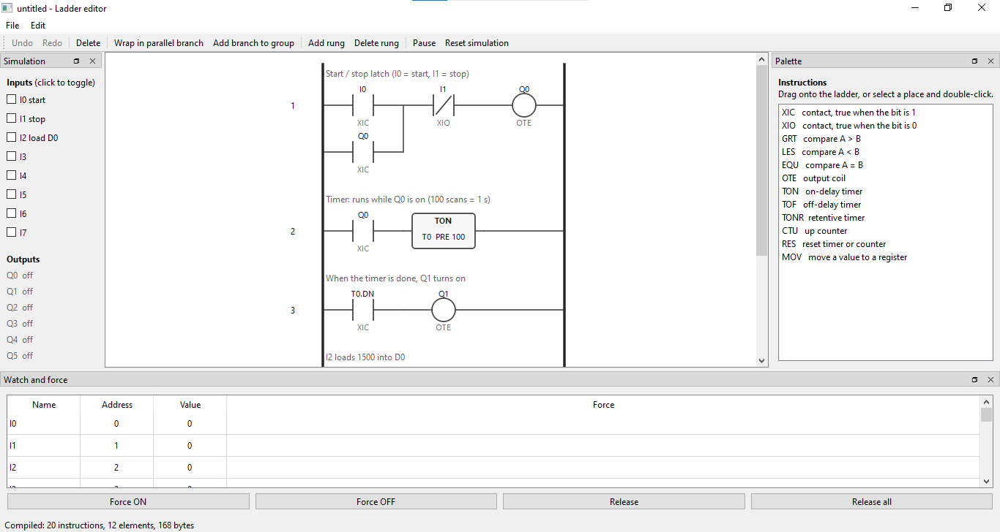
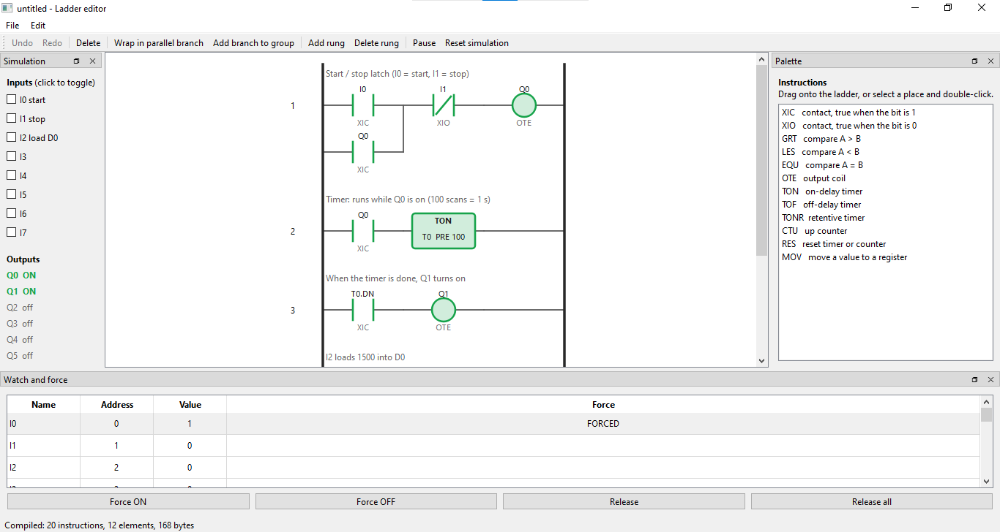
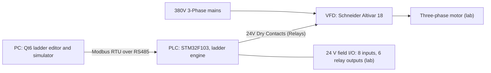

# Educational Industrial Automation Kit

A low-cost teaching kit for industrial automation: a custom **PLC**, a **Qt6 ladder editor with simulator**, and integration with a commercial **Schneider Altivar 18 VFD**, designed for lab practicals at EPAC (École Polytechnique d'Abomey-Calavi, Benin).

Final-year project by Peace Georland ADIKPETO, Electrical Engineering, Industrial Process Control.

> **Status as of November 2026:** The ladder software (engine, compiler, editor, simulator, watch/force table) is complete and tested. The hardware (Blue Pill PLC shield) is being built. The project has pivoted to using the lab's Altivar 18 VFD via discrete terminal wiring, eliminating the high-voltage risks of building a custom VFD.

## Screenshots

---

## Contents

1. [Goal and scope](#goal-and-scope)
2. [Project status](#project-status)
3. [System architecture](#system-architecture)
4. [Ladder software](#ladder-software)
5. [Hardware design (planned)](#hardware-design-planned)
6. [Student safety concept](#student-safety-concept)
7. [Building and running the software](#building-and-running-the-software)
8. [Repository layout](#repository-layout)
9. [Roadmap](#roadmap)
10. [Design decisions](#design-decisions)
11. [Cost](#cost)

---

## Goal and scope

Commercial PLC and drive trainers are expensive and closed. This project builds an open, hand-solderable alternative that students can use to learn ladder logic, Modbus communication and variable-speed motor control on real equipment.

**In the kit (built in this project)**

- **PLC board:** 8 opto-isolated 24 V inputs, 6 relay outputs (24 V only), RS485 port, 10 ms scan cycle, custom ladder interpreter.
- **Qt6 ladder editor:** Drag-and-drop interface with a built-in simulator that runs the exact same C engine as the PLC. Includes a live Watch & Force table.
- **Six lab exercises** and a student guide.

**Provided by the lab**

- **Schneider Altivar 18 (ATV18)** VFD (7.5 kW).
- Three-phase motor (0.37 to 0.75 kW), contactors, e-stop, earthed bench supply with RCD, sensors and loads.

**Out of scope**

- Sensorless vector control.
- OpenPLC compatibility (it needs a Linux-class processor, not a microcontroller).
- Custom VFD power stage (replaced by the commercial Altivar 18).

---

## Project status

| Area | Status | Notes |
|---|---|---|
| Ladder engine (portable C) | Done | 12 instructions, validated program loading, forcing, 76 unit checks |
| Ladder compiler (C++/Qt) | Done | Rung tree to bytecode, CRC, animation ids, 25 checks |
| Ladder editor (Qt6) | Done | Drag-and-drop, operand editing, parallel branches, undo/redo, JSON save/load, 118 checks |
| Simulator & Backend (Qt6) | Done | Isolates UI from C engine, supports forcing, 23 checks |
| Watch & Force Model (Qt6) | Done | QAbstractTableModel for live I/O monitoring and forcing, 21 checks |
| Modbus link between editor and PLC | Not started | Needs the PLC register map and a board to test against |
| PLC board and firmware | In progress | STM32F103 (Blue Pill) shield with PC817 inputs, ULN2003A/relays, MAX485 |
| VFD integration | In progress | Terminal control via PLC relays to ATV18 logic inputs (no Modbus on ATV18) |
| Lab exercises and student guide | Not started | |

---

## System architecture

The PLC is Modbus slave towards the PC. It controls the ATV18 VFD using discrete relay outputs connected to the drive's logic inputs (LI1-LI4). The same ladder engine source file runs on the PLC firmware and inside the editor's simulator.

---

## Ladder software

### Engine (`engine/`)

Plain C with no hardware dependency. Call `ld_scan()` every 10 ms.

- **Instruction set:** XIC, XIO, OTE, TON, TOF, TONR, CTU, RES, GRT, LES, EQU, MOV.
- **Structure:** series elements and nested parallel branches (up to 4 levels).
- **Limits:** 512 instructions, 256 animation ids, 16 timers, 16 counters.
- **Forcing:** `ld_force_input` and `ld_force_output` allow overriding physical bits from the HMI.
- **Program image:** 8-byte header (magic, version, instruction count, Modbus CRC-16).

### Editor (`editor/`)

Qt6 Widgets application.

- Drag instructions from the palette onto the ladder.
- Wrap a contact in a parallel branch, add branches, rung comments.
- Undo and redo, save and open as JSON.
- Live simulator: toggle inputs, watch outputs and elements turning green.
- **Watch & Force Table:** View live states of I0-I7 and Q0-Q5. Force bits ON/OFF to test logic without physical hardware.

---

## Hardware design (planned)

### PLC

| Item | Choice |
|---|---|
| Controller | STM32F103C8T6 (Blue Pill) |
| Inputs | 8 x 24 V, PC817 optocouplers |
| Outputs | 6 relays driven by ULN2003A, rated and labeled for 24 V only |
| Communication | RS485 via MAX485 module (slave towards the PC) |

### VFD Integration

| Item | Choice |
|---|---|
| Drive | Schneider Altivar 18 (Lab Provided) |
| Control Method | Terminal wiring (Run Fwd, Run Rev, Preset Speeds) via PLC relays |
| Feedback | Fault relay (SA/SB) wired to PLC Input I7 |

---

## Student safety concept

- Shrouded, finger-safe power terminals on the PLC.
- Relay outputs limited to 24 V (students never touch 380V).
- The ATV18 VFD enclosure is closed; students interact only via the PLC's low-voltage terminals.
- Bus-live LED and a three-minute wait rule after switching off the VFD.

---

## Building and running the software

**Requirements:** Qt 6 with the Widgets and SerialBus modules, and a C/C++ compiler.

1. Open `plc_kit.pro` in Qt Creator and choose **Build All**.
2. Run the test programs: `test_engine` (76), `test_compiler` (25), `test_edit` (118), `test_backend` (23), `test_watchmodel` (21). Total: 263 checks.
3. Choose `ladder_editor` as the run target.

---

## Roadmap

**Software**

- [x] Ladder engine, interface spec and unit tests
- [x] Compiler from rung tree to bytecode
- [x] Editor with drag and drop, operand editing, branches, undo/redo, save/load
- [x] Live simulator with element animation
- [x] Watch and force table, forcing inside the C engine
- [ ] Symbol names for addresses
- [ ] PLC Modbus register map, portable Modbus slave handler, editor link (upload, live polling)

**Hardware and firmware**

- [ ] Build the PLC shield (solder PC817, relays, MAX485).
- [ ] Wire the PLC to the ATV18 (Q0->LI1, Q1->LI2, Q2->LI3, Q3->LI4).
- [ ] Bring-up: Flash the Blue Pill, test Modbus link from Qt.
- [ ] PLC firmware: scan loop, I/O, Modbus slave, forcing, program upload.
- [ ] Six lab exercises and the student guide.

---

## Design decisions

- **Commercial VFD instead of custom:** Eliminates the risk of building a 310V power stage and speeds up the project timeline.
- **Terminal control:** The ATV18 does not support Modbus. The PLC uses dry contacts to drive the VFD logic inputs, which is standard industrial practice.
- **Bytecode instead of text on the target:** The editor compiles to a compact image that the PLC executes directly.
- **One portable engine:** The same C file runs on the PLC and in the simulator.
- **Through-hole parts:** Hand-soldering removes assembly costs.

---

## Cost

The estimated cost of one complete kit (PLC shield only) is well under 120CHF, as the lab provides the VFD and motor.

---

## License and contact

License: GNU General Public License v2.0

Author: Peace Georland ADIKPETO, EPAC, Benin.
