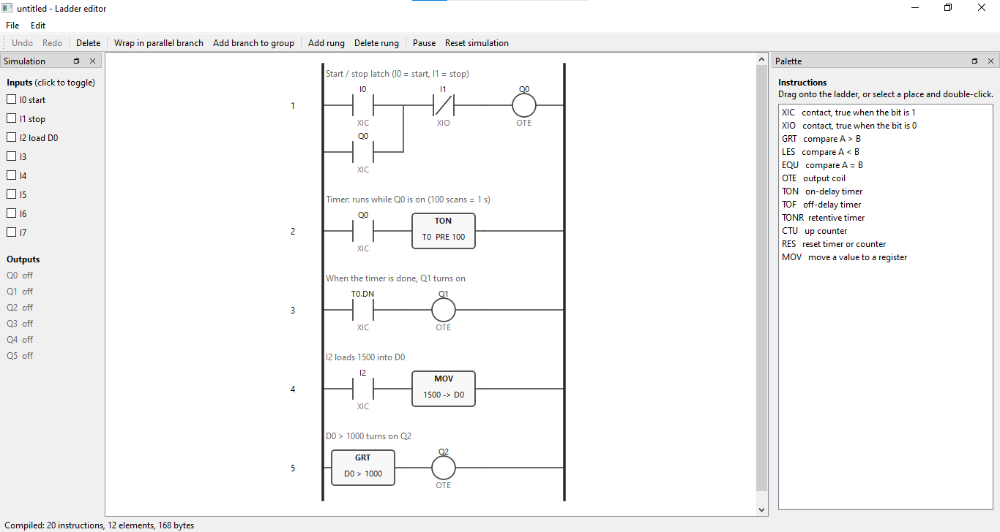
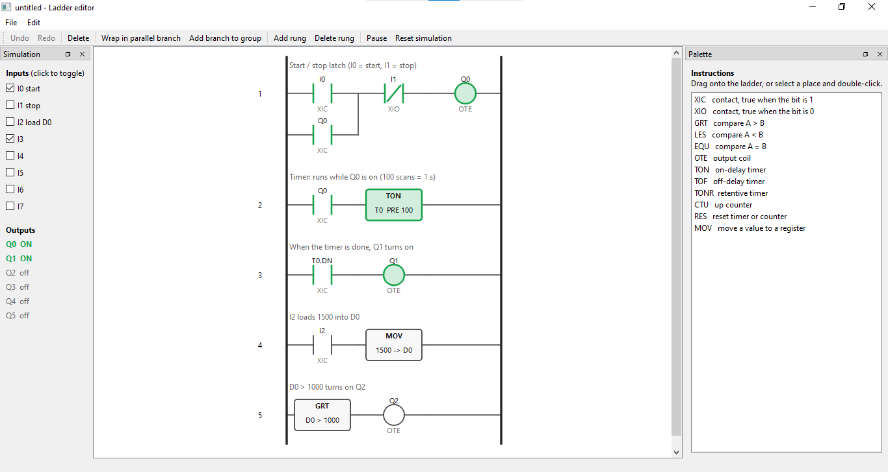
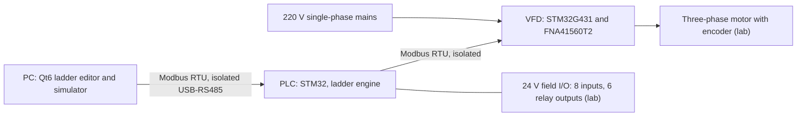

# Educational Industrial Automation Kit

  

A low-cost teaching kit for industrial automation: a custom **PLC**, a custom **0.75 kW variable frequency drive (VFD)** and a **Qt6 ladder editor with simulator**, designed for lab practicals at EPAC (École Polytechnique d'Abomey-Calavi, Benin).

Final-year project by Peace Georland ADIKPETO, Electrical Engineering, Industrial Process Control.

> **Status as of 30 October 2026:** the ladder software (engine, compiler, editor, simulator) is complete and tested. The hardware (PLC board and VFD board) and the firmware have not been started. See [Project status](#project-status).

## Screenshots

<!-- Uncomment when the images are added to docs/images/


-->

*Screenshots coming soon.*

---

## Contents

1. [Screenshots](#screenshots)
2. [Goal and scope](#goal-and-scope)
3. [Project status](#project-status)
4. [System architecture](#system-architecture)
5. [Ladder software](#ladder-software)
6. [Hardware design (planned)](#hardware-design-planned)
7. [Student safety concept](#student-safety-concept)
8. [Building and running the software](#building-and-running-the-software)
9. [Repository layout](#repository-layout)
10. [Roadmap](#roadmap)
11. [Known limitations](#known-limitations)
12. [Design decisions](#design-decisions)
13. [Cost](#cost)
14. [Contributing](#contributing)
15. [License and contact](#license-and-contact)

---

## Goal and scope

Commercial PLC and drive trainers are expensive and closed. This project builds an open, hand-solderable alternative that students can use to learn ladder logic, Modbus communication and variable-speed motor control on real equipment.

**In the kit (built in this project)**

- PLC board: 8 opto-isolated 24 V inputs, 6 relay outputs (24 V only), two RS485 ports, 10 ms scan cycle, custom ladder interpreter.
- VFD board: 0.75 kW, 220 V single-phase input, three-phase output, three control modes (V/f, encoder speed PI, optional process PID cascade), Modbus RTU slave.
- Qt6 ladder editor with a built-in simulator that runs the same C engine as the PLC.
- Six lab exercises and a student guide.

**Provided by the lab**

- Three-phase motor (0.37 to 0.75 kW), contactors, e-stop, earthed bench supply with RCD, sensors and loads. Students connect them to the kit's terminals.

**Out of scope**

- Sensorless vector control.
- OpenPLC compatibility (it needs a Linux-class processor, not a microcontroller).

---

## Project status

| Area | Status | Notes |
|---|---|---|
| Ladder engine (portable C) | Done | 12 instructions, validated program loading, 57 unit checks |
| Ladder compiler (C++/Qt) | Done | Rung tree to bytecode, CRC, animation ids, 25 checks |
| Ladder editor (Qt6) | Done | Drag and drop, operand editing, parallel branches, undo/redo, JSON save/load, live simulator, 118 checks |
| Modbus link between editor and PLC | Not started | Needs the PLC register map and a board to test against |
| PLC board and firmware | Not started | Controller choice pending (Black Pill F401 or Blue Pill F103) |
| VFD board and firmware | Not started | IPM lifecycle status and footprint to be verified before layout |
| Safety concept and terminal map | Draft v0.1 | Awaiting supervisor approval |
| Bill of materials | v2 prepared | Through-hole parts; prices are estimates, not quotes |
| Lab exercises and student guide | Not started | |

---

## System architecture



The PLC is Modbus master towards the VFD and Modbus slave towards the PC. The same ladder engine source file runs on the PLC firmware and inside the editor's simulator, so a program behaves identically in both.

---

## Ladder software

### Engine (`engine/`)

Plain C with no hardware dependency. Call `ld_scan()` every 10 ms.

- **Instruction set:** XIC, XIO, OTE, TON, TOF, TONR, CTU, RES, GRT, LES, EQU, MOV.
- **Structure:** series elements and nested parallel branches (up to 4 levels). No bridge circuits.
- **Limits:** 512 instructions, 256 animation ids, 16 timers, 16 counters, signed 16-bit comparisons.
- **Program image:** 8-byte header (magic, version, instruction count, Modbus CRC-16) followed by 8-byte instructions. A new image is fully validated before it replaces the running program, so a bad upload cannot break a running PLC.
- **Animation:** after each instruction the engine records the rung power in `elem_power[id]`, which the editor uses to light up elements.
- **Memory:** about 6.5 KB.

The bit and register address maps, the image format and the instruction semantics are in [`engine/SPEC.md`](engine/SPEC.md).

### Editor (`editor/`)

Qt6 Widgets application.

- Drag instructions from the palette onto the ladder, or select a place and double-click.
- Double-click an element to edit its operands (`I0`, `Q3`, `T0.DN`, `D5`, constants, presets). Invalid input is rejected with a message.
- Wrap a contact in a parallel branch, add branches, add and delete rungs, rung comments.
- Undo and redo, save and open as JSON.
- Live simulator: toggle inputs I0 to I7, watch outputs Q0 to Q5 and the elements turning green, one scan every 10 ms.
- Compile errors are shown immediately (for example an output inside a branch).

Internally the editor is split into a GUI-free editing core (`ProgramEditor`, fully unit-tested), the compiler, the scene and the window.

---

## Hardware design (planned)

None of the hardware has been built yet. This section records the design decisions taken so far.

### VFD

| Item | Choice |
|---|---|
| Power stage | FNA41560T2 intelligent power module, 600 V 15 A, 26-pin through-hole package |
| Controller | STM32G431 on a NUCLEO-G431RB module, PWM from TIM1 (the G431 has no HRTIM) |
| PWM | 10 kHz sinusoidal, third-harmonic injection to reach about 220 V line-to-line, dead-time 2 µs |
| DC bus | 310 V from a KBPC2510 bridge, 2 x 470 µF 400 V, bleed resistors, inrush NTC |
| Current sensing | ACS712-20A on two phases, short-circuit trip on a 0.05 ohm shunt (about 10 A) |
| Control modes | V/f open loop; encoder PI speed loop at 1 kHz; process PID cascade (optional) |
| Interfaces | Modbus RTU slave, incremental encoder, enable input; all isolated from the live side |

Protections: IPM fault latched through the TIM1 break input, enable input on the second break input, DC bus overvoltage trip at about 375 V, software overcurrent trip, Modbus timeout (ramp down, then latch a fault), watchdog, no automatic restart after a fault.

Values for the module's external circuit (input filters, short-circuit filter, bootstrap and supply capacitors, zener) come from the FNA41560T2 datasheet and are listed in the BOM notes. **To verify before layout:** the module's lifecycle status, the footprint from the datasheet outline (distributor listings disagree on the package code), and the TIM1 pin availability on the Nucleo headers.

### PLC

| Item | Choice |
|---|---|
| Controller | Black Pill STM32F401 (or Blue Pill STM32F103); software is identical, the pinout differs |
| Inputs | 8 x 24 V, PC817 optocouplers |
| Outputs | 6 relays, rated and labeled for 24 V only |
| Communication | Two RS485 ports: master towards the VFD, slave towards the PC |

### Build approach

Through-hole parts hand-soldered by the author, MCU boards plugged into sockets, no assembly service. The only SMD parts are the ACS712 current sensors (SOIC-8).

---

## Student safety concept

The kit is meant for supervised lab sessions. The VFD's logic ground sits at DC bus potential, so the following measures keep students away from live parts:

- Shrouded, finger-safe power terminals, wired only with the supply off.
- Closed VFD enclosure, opened with a tool by the instructor only.
- All student-accessible terminals isolated from the mains: RS485, encoder, enable.
- External enable input; faults are latched and never restart automatically.
- Bus-live LED and a three-minute wait rule after switching off.
- Relay outputs limited to 24 V.
- Instructor-only bench work (scope, USB debugging) is done behind an isolation transformer, with a series bulb for the first power-up.

The full draft is in [`docs/safety_concept_terminal_map_v0.1.docx`](docs/safety_concept_terminal_map_v0.1.docx) (safety concept and terminal map, v0.1).

> **Warning:** this project involves mains voltage and a 310 V DC bus. It is not a certified product. Do not build or operate it without qualified supervision and proper safety equipment.

---

## Building and running the software

**Requirements:** Qt 6 with the Widgets module and a C/C++ compiler. Developed and tested with Qt 6.11.2 (MinGW 64-bit) on Windows; also builds with Qt 6.4 on Linux. The project uses qmake.

1. Open `plc_kit.pro` in Qt Creator and choose **Build All**.
2. Run the test programs `test_engine`, `test_compiler` and `test_edit`. Each prints a line such as `118 checks, 0 failures`.
3. Choose `ladder_editor` as the run target and start it.

Quick start in the editor: press `Ctrl+N`, drag an XIC and an OTE onto the rung, toggle I0 in the simulation panel and watch Q0. Build a start/stop latch by wrapping the start contact in a parallel branch (`Ctrl+B`) and putting a contact for Q0 in the new branch.

Naming note: do not name a function `emit()` in Qt code, because `emit` is a Qt macro.

---

## Repository layout

```
plc_kit.pro            qmake subdirs project
engine/                portable C ladder engine, SPEC.md, unit tests
editor/                Qt6 editor: model, compiler, editing core, scene, window, tests
docs/                  documentation: BOM, safety concept, images
  images/
hardware/              KiCad projects for the PLC and VFD   (planned)
firmware/              PLC and VFD firmware                 (planned)
```

---

## Roadmap

**Software**

- [x] Ladder engine, interface spec and unit tests
- [x] Compiler from rung tree to bytecode
- [x] Editor with drag and drop, operand editing, branches, undo/redo, save/load
- [x] Live simulator with element animation
- [ ] Watch and force table, forcing inside the C engine
- [ ] Symbol names for addresses
- [ ] Wire animation, trending
- [ ] PLC Modbus register map, portable Modbus slave handler, editor link (upload, live polling)

**Hardware and firmware**

- [ ] Decide the PLC controller, verify the IPM status and footprint, check Nucleo pins
- [ ] VFD and PLC schematics and layout, PCB order
- [ ] VFD control core in portable C, validated against a motor model on the PC
- [ ] Bring-up in four stages: MCU boards only; IPM on a 24 V bus; 310 V through an isolation transformer and series bulb; motor in V/f, then encoder PI
- [ ] PLC firmware: scan loop, I/O, two Modbus ports, forcing, program upload
- [ ] VFD firmware: SPWM, V/f, current and bus sensing, encoder PI, fault state machine

**Validation and documentation**

- [ ] Dead-time measured on an oscilloscope, IPM fault demonstration, Modbus timeout behavior
- [ ] Failure-mode table (detection, response, recovery for each fault)
- [ ] Six lab exercises and the student guide
- [ ] Defense

---

## Known limitations

- Ladder rungs are series and parallel only; bridge circuits are not supported.
- Wrapping in a branch applies to one contact at a time; elements cannot be moved by dragging yet (delete and insert instead).
- Only elements are animated, not the wires between them.
- The editor currently runs the simulator only; it cannot talk to a PLC yet.
- Timer and counter presets are constants.

---

## Design decisions

- **Bytecode instead of text on the target.** The editor compiles to a compact image that the PLC executes directly. It keeps upload simple and parsing off the microcontroller.
- **One portable engine.** The same C file runs on the PLC and in the simulator, so lab programs can be developed without hardware.
- **Custom interpreter instead of OpenPLC.** OpenPLC needs a Linux-class processor.
- **TIM1 instead of HRTIM on the VFD.** The G431 has no HRTIM, and TIM1's complementary outputs, dead-time generator and two break inputs are sufficient for a 10 kHz inverter.
- **24 V relay outputs.** Students will wire these terminals, so mains is kept off them.
- **Through-hole parts.** Hand-soldering removes the assembly cost and keeps the board repairable in a lab.

---

## Cost

The estimated cost of one complete kit (PLC, VFD, PCBs) is about 125,000 FCFA. This is above the original 80,000 FCFA target, mainly because of the IPM, the isolation parts and the PCBs. The estimate comes from the BOM ([`docs/BOM_v2_THT_PLC_VFD_kit.xlsx`](docs/BOM_v2_THT_PLC_VFD_kit.xlsx)); prices are estimates, not quotes.

---

## Contributing

Issues and suggestions are welcome, especially on the safety concept and the lab exercises. For code changes:

- Open an issue first for anything larger than a small fix.
- Keep the engine in `engine/` free of any hardware or Qt dependency.
- Add or update a unit test for every change, and run `test_engine`, `test_compiler` and `test_edit` before opening a pull request.
- Hardware changes must keep the student-safety measures described above.

---

## License and contact

License: to be defined.

Author: Peace Georland ADIKPETO, EPAC, Benin.
Supervisor: to be added.
